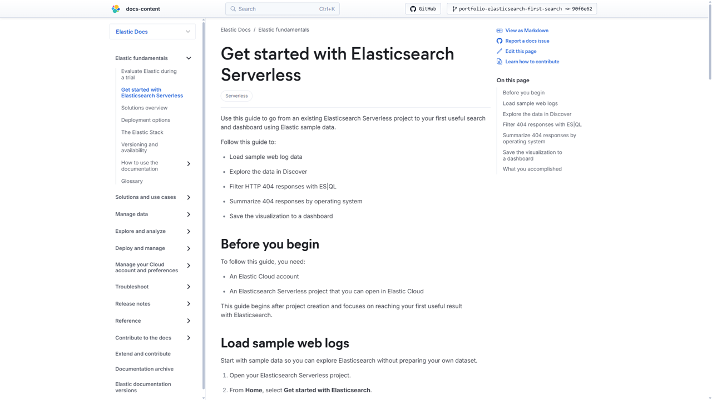

# Elasticsearch Serverless First-Search Documentation Portfolio Project

This branch contains an independently created technical-writing portfolio project built against Elastic's public `docs-content` repository and documentation toolchain.

> **Portfolio project:** This work was created independently for professional evaluation. It is not official Elastic documentation and was not commissioned, reviewed, or published by Elastic.

## Project overview

The goal of this project was to create a task-oriented onboarding experience that takes a new Elasticsearch Serverless user from sample data to a useful, saved analysis.

The walkthrough covers a complete first-value workflow:

1. Load Elastic sample web logs.
2. Explore documents and fields in Discover.
3. Filter HTTP 404 responses with ES|QL.
4. Aggregate 404 responses by client operating system.
5. Create a visualization from the results.
6. Save the visualization to a dashboard.

## Primary documentation sample

**[Get started with Elasticsearch Serverless](get-started/elasticsearch-serverless-first-search.md)**

> **Viewing note:** GitHub's standard Markdown preview does not process Elastic documentation substitutions such as `{{es}}` and `{{ecloud}}`. These render as **Elasticsearch** and **Elastic Cloud** when the page is built with Elastic's documentation toolchain. The sample was validated in the rendered Elastic documentation interface.

### Rendered documentation preview

*Rendered locally with Elastic's documentation toolchain. GitHub's standard Markdown preview does not process Elastic-specific substitutions used in the source.*

The sample was authored directly within Elastic's public documentation repository structure and follows the repository's front matter, navigation, substitution, Markdown, and build conventions.

## What this project demonstrates

- Task-oriented onboarding and getting-started documentation
- Hands-on product research and workflow validation
- Elasticsearch Serverless and Discover usage
- Tested ES|QL queries and aggregation examples
- Screenshot-based procedural guidance
- Information architecture and table-of-contents integration
- Elastic documentation substitutions such as `{{es}}` and `{{ecloud}}`
- Local rendering with Elastic's `docs-builder`
- Git branching, commits, validation, and version-control workflow
- Attention to usability, accuracy, visual clarity, and first-time-user experience

## Supporting visuals

The walkthrough includes original screenshots captured while performing the documented workflow:

- Sample web logs installation state
- Discover with sample log data
- HTTP 404 analysis grouped by operating system
- Completed Web Log 404 Analysis dashboard

The source images are stored in [`get-started/images`](get-started/images).

## Validation

The documentation was rendered and reviewed locally using Elastic's documentation toolchain.

The authored page and its `get-started/toc.yml` integration produced no build diagnostics.

A separate clean validation worktree was used to isolate unrelated upstream repository build issues from the portfolio work. In that validation environment, the documentation build completed with **0 errors and 0 warnings**.

The walkthrough was also reviewed in the rendered Elastic documentation interface to verify:

- Navigation and section hierarchy
- Code-block rendering
- Image placement
- Product substitutions
- Procedural sequence
- Readability and visual presentation

## Repository structure

The portfolio-specific changes on this branch are intentionally limited to:

- `get-started/elasticsearch-serverless-first-search.md`
- `get-started/toc.yml`
- Four supporting PNG screenshots
- This `PORTFOLIO.md` overview

This keeps the portfolio work distinct from the upstream Elastic repository.

## Authorship and source note

Elastic, Elasticsearch, ES|QL, and related product names are referenced solely to identify the technologies demonstrated in this portfolio project.

This project uses Elastic's publicly available repository, product interface, documentation tooling, and sample data solely to demonstrate technical-writing and documentation-engineering skills.